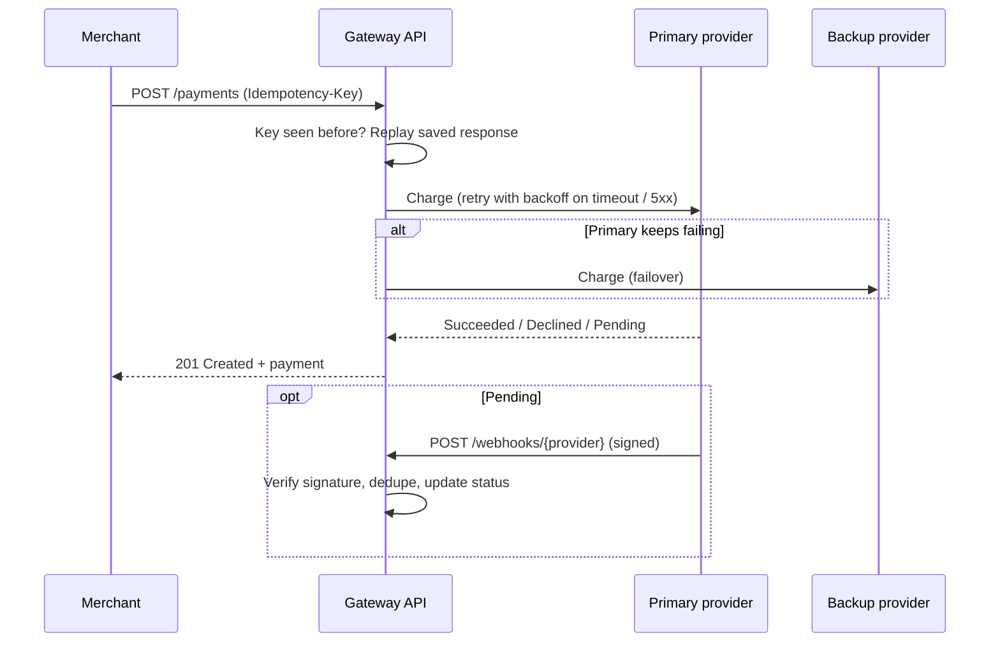

# Payment Gateway API

[](https://github.com/VerginisV/payment-gateway-api/actions/workflows/ci.yml)

An ASP.NET Core (.NET 10) API that sits between merchants and several payment providers. It focuses on the parts that make payment systems hard in production: **charging exactly once**, **surviving provider outages**, and **trusting asynchronous webhooks safely**.

The providers are simulated, so every scenario (declines, timeouts, outages, delayed results) can be reproduced on your own machine with a single request.

## What it demonstrates

| Problem | How it is handled |
| --- | --- |
| A client times out and retries: did the customer pay twice? | `Idempotency-Key` header on every POST. Retries return the original response; reusing a key with a different body is rejected (422); two requests racing with the same key get 409. |
| The provider times out or returns 5xx | Retries with exponential backoff and jitter. Only transient errors are retried, never declines. The same idempotency key goes to the provider on each retry, so a retry can't double charge. |
| The primary provider is down | Automatic failover to the next provider that supports the payment method and currency. |
| The result arrives later by webhook | `Pending` status, then a signed webhook completes the payment. |
| Someone sends a fake webhook | HMAC-SHA256 signature over timestamp and body, constant-time comparison, 5-minute replay window. |
| The provider sends the same webhook twice, or out of order | Events are deduplicated by ID, and a finished payment never moves backwards. |
| A refund and a webhook hit the same payment at once | Per-payment async lock plus optimistic concurrency (version check) on save. Concurrent refunds can never exceed the paid amount (covered by a test). |
| Invalid state changes (refunding a declined payment) | The `Payment` entity owns its state machine; invalid transitions throw. |

## How a payment flows



## Try every scenario

The simulated providers decide the outcome from the **last two digits of the amount**, like the test card numbers real providers publish:

| Amount ends in | Result |
| --- | --- |
| `13` | Declined (`insufficient_funds`), not retried, not failed over |
| `42` | Provider fails twice with HTTP 503, third attempt succeeds |
| `77` | `Pending`; completed later by webhook |
| `99` | Primary provider is down; succeeds on the backup |
| `98` | Every provider is down; payment `Failed` |
| anything else | Succeeds |

Card payments go to `acmepay` (primary) with `novapay` as backup. Wallet payments go to `novapay`.

## Run it

Requires the [.NET 10 SDK](https://dotnet.microsoft.com/download).

```bash
dotnet run --project src/PaymentGateway.Api
# Listening on http://localhost:5080 (Development settings: API key "dev_key_change_me")
```

Create a payment:

```bash
curl -s http://localhost:5080/payments \
  -H "Content-Type: application/json" \
  -H "X-Api-Key: dev_key_change_me" \
  -H "Idempotency-Key: order-1001-attempt" \
  -d '{"amountMinorUnits":1042,"currency":"EUR","method":"Card","merchantReference":"order-1001"}'
```

The response lists every provider attempt, so retries and failover are visible:

```json
{
  "status": "Succeeded",
  "provider": "acmepay",
  "attempts": [
    { "provider": "acmepay", "attemptNumber": 1, "outcome": "error: acmepay returned HTTP 503 (attempt 1)." },
    { "provider": "acmepay", "attemptNumber": 2, "outcome": "error: acmepay returned HTTP 503 (attempt 2)." },
    { "provider": "acmepay", "attemptNumber": 3, "outcome": "succeeded" }
  ]
}
```

To complete a pending payment (amount ending in `77`), let the built-in simulator send a signed webhook (Development only):

```bash
curl -s http://localhost:5080/dev/simulate-webhook \
  -H "Content-Type: application/json" \
  -d '{"provider":"acmepay","providerPaymentId":"<providerPaymentId from the response>"}'
```

`requests.http` contains every scenario for the Visual Studio or Rider HTTP client.

### With Docker

```bash
docker build -t payment-gateway-api .
docker run -p 8080:8080 \
  -e ApiKeys__Keys__0=my_api_key \
  -e Providers__WebhookSecrets__acmepay=my_webhook_secret \
  payment-gateway-api
```

## API

All `/payments` endpoints need an `X-Api-Key` header. Amounts are in minor units (cents) to avoid floating point errors.

| Method | Path | Notes |
| --- | --- | --- |
| `POST` | `/payments` | Requires `Idempotency-Key`. Returns `201` with the payment. |
| `GET` | `/payments/{id}` | |
| `POST` | `/payments/{id}/refunds` | Requires `Idempotency-Key`. Partial and full refunds. |
| `POST` | `/webhooks/{provider}` | Called by providers. Authenticated by `X-Signature: t=<unix>,v1=<hmac>`. |
| `GET` | `/health` | Public, for load balancers. |

Errors use the standard [Problem Details](https://www.rfc-editor.org/rfc/rfc9457) format.

## Project structure

```
src/PaymentGateway.Api
├── Domain/          Payment entity and its state machine, Money
├── Payments/        PaymentService (charging, failover, refunds) and endpoints
├── Providers/       IPaymentProvider, simulated providers, routing
├── Resilience/      Retry policy with exponential backoff and jitter
├── Idempotency/     Idempotency key store and request wrapper
├── Webhooks/        Signature verification, event processing, dev simulator
├── Persistence/     Repository with optimistic concurrency
├── Concurrency/     Per-key async lock
└── Security/        API key middleware
tests/PaymentGateway.Tests   55 xUnit tests: unit tests plus HTTP tests against the running app
```

## Tests

```bash
dotnet test
```

The suite covers the state machine, signature verification (tampering, wrong secret, replay, malformed headers), idempotency (replay, mismatch, in-progress, expiry), retries and backoff, failover, webhook deduplication and ordering, concurrent refunds, and the HTTP API end to end. CI runs it on every push.

## Design choices

- **No external packages in the API.** Retries, idempotency and signatures are written by hand to show how they work. In a team codebase I would use Polly for resilience.
- **In-memory storage behind an interface.** `IPaymentRepository` already enforces optimistic concurrency, so a database version (for example EF Core with a `rowversion` column) is a drop-in replacement.
- **Single-instance locking.** `KeyedLock` and the idempotency store live in memory. Running several instances would need Redis or database-backed equivalents.

## What a production version would add

- A real database, and an outbox table for reliable merchant notifications
- Real provider adapters (each provider's HTTP API mapped to `IPaymentProvider`)
- Distributed idempotency and locking (Redis)
- OpenTelemetry tracing and metrics per provider, to alert on rising decline or timeout rates
- PCI DSS scope reduction: tokenised card data only, never raw card numbers

## License

MIT
